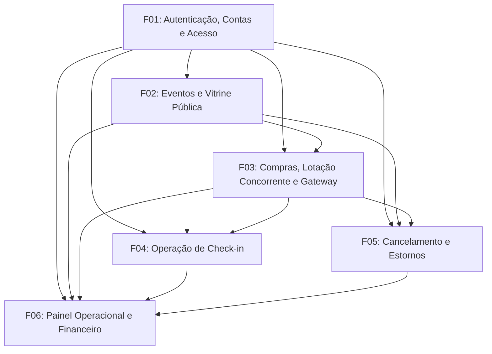

# PRD — Catraca (MVP de Venda e Operação de Ingressos)

## 1. Visão Geral do Produto

A **Catraca** é uma plataforma de venda e operação de ingressos para eventos de pequeno porte (shows em bar, workshops, meetups). O produto atende quatro perfis de uso:

- **Visitante**: navega sem autenticação pela vitrine pública de eventos publicados.
- **Participante**: cria a própria conta (nome, e-mail e senha), autentica-se, encerra sessão, compra ingressos na vitrine e acompanha seus ingressos em **"Meus ingressos"**.
- **Organizador**: acessa com conta provisionada pela seed (sem auto-cadastro), cria, edita, publica, cancela e opera seus próprios eventos (check-in e painel operacional/financeiro), isolado dos eventos de outros organizadores.
- **Parceiro**: sistema externo que consulta eventos disponíveis, realiza compras e consulta ingressos via **API de Parceiros** (`/api/partner/*`) autenticada pelo cabeçalho `X-Api-Key`.

### Estados de Ingresso e Convenção Interface vs. API

| Valor na API | Rótulo na Interface | Quando se aplica |
| :--- | :--- | :--- |
| `pending` | `pendente` | Compra criada, ocupando vaga e aguardando resposta assíncrona do gateway |
| `confirmed` | `confirmado` | Pagamento aprovado pelo gateway |
| `declined` | `recusado` | Pagamento recusado pelo gateway (vaga liberada) |
| `cancelled` | `cancelado` | Estava `pending` quando o evento foi cancelado |
| `refunded` | `estornado` | Estava `confirmed` quando o evento foi cancelado |

> **Check-in separado de status**: Ter passado pelo check-in não altera o `status` do ingresso; é registrado separadamente no campo booleano `checkedIn` (`true` / `false`).

---

## 2. Catálogo de Features, Provides e Consumes

O MVP está estruturado em **6 features (`F01` a `F06`)** organizadas para garantir contratos explícitos e integridade quando combinadas:

### `F01` — Autenticação, Contas e Controle de Acesso (`F01-auth-access`)
- **Resumo**: Cadastro de participante, login/logout por sessão, contas de organizador e participante vindas da seed, proteção da área de organizador e autenticação de parceiros via `X-Api-Key`.
- **Consumes**:
  - Infraestrutura base do harness (PostgreSQL, tabela `users`, seed idempotente e variável `PARTNER_API_KEY`).
- **Provides**:
  - Endpoints `/api/auth/register`, `/api/auth/login`, `/api/auth/logout`, `/api/auth/me`.
  - Middlewares `requireAuth`, `requireParticipant`, `requireOrganizer` (bloqueando visitantes e participantes na área de organizador — **R13**) e `requirePartnerApiKey` (respondendo `401 {"error":"unauthorized"}` quando ausente ou inválida).
  - Telas de Login, Cadastro de Participante, cabeçalho de sessão e guarda de rotas de organizador no frontend.

### `F02` — Ciclo de Vida de Eventos e Vitrine Pública (`F02-events-showcase`)
- **Resumo**: Criação, edição e publicação de eventos pelo organizador, página dedicada de gestão do evento, isolamento por dono (**R13**), vitrine pública e listagem da API de parceiros.
- **Consumes**:
  - `F01`: `requireOrganizer` (identidade do organizador autenticado), `requirePartnerApiKey` e guarda de navegação no frontend.
- **Provides**:
  - Modelo e persistência `events` (`id`, `organizer_id`, `name`, `starts_at`, `location`, `capacity`, `price_cents`, `status` em `draft | published | cancelled`).
  - Endpoints do organizador: `GET /api/organizer/events`, `POST /api/organizer/events`, `GET /api/organizer/events/:eventId`, `PATCH /api/organizer/events/:eventId`, `POST /api/organizer/events/:eventId/publish`.
  - Endpoints públicos e de parceiro: `GET /api/events` (vitrine) e `GET /api/partner/events` (contrato fixo com `availableSeats` conforme **R05**).
  - Página de gestão `/organizer/events/:eventId` (**R04**) com slots de integração para Check-in (`F04`), Cancelamento (`F05`) e Painel (`F06`), ocultando integralmente dados de outros organizadores (**R13**).

### `F03` — Compra de Ingressos, Lotação Concorrente, Gateway Simulado e API de Parceiros (`F03-purchases-gateway`)
- **Resumo**: Compra unitária pela vitrine e pela API de parceiros, controle transacional de lotação sob alta concorrência (`SELECT ... FOR UPDATE`), gateway simulado assíncrono, consulta de ingresso na API de parceiros e página "Meus ingressos".
- **Consumes**:
  - `F01`: `requireParticipant` (compras na vitrine e "Meus ingressos") e `requirePartnerApiKey` (rotas de compra e consulta de parceiros).
  - `F02`: registros de `events` (status, `capacity`, `price_cents` vigente), regra de vagas ocupadas para validação de redução de lotação (**R03**) e vitrine/listagem de eventos (**R05**).
- **Provides**:
  - Modelo e persistência `tickets` (`id`, `code`, `event_id`, `participant_id`, `buyer_email`, `channel`, `price_cents`, `status`, `checked_in`, `checked_in_at`, `created_at`, `updated_at`).
  - Compra na vitrine (`POST /api/events/:eventId/purchases`) e listagem do participante (`GET /api/my-tickets`, tela `/my-tickets` — **R09**).
  - Rotas de parceiro com contrato fixo: `POST /api/partner/events/:eventId/purchases` (`202`, `422 invalid_request`, `404 event_not_available`, `409 sold_out`) e `GET /api/partner/tickets/:ticketId` (`200`, `404 ticket_not_found`).
  - Simulador assíncrono de gateway (finais `0001`, `0002`, `0003`, `0004` e demais; validação estrita de 16 dígitos) atualizando apenas ingressos ainda `pending` (**R08**, preparando **R11**).
  - Cálculo real de vagas ocupadas (`pending + confirmed`) consumido pela trava de edição de lotação de `F02` (**R03**, **R05**) e proteção contra overselling sob compras simultâneas (**R07**).

### `F04` — Operação de Check-in do Evento (`F04-checkin`)
- **Resumo**: Validação e registro de entrada de ingressos na página de gestão do evento seguindo estritamente a árvore de prioridade de **R10**.
- **Consumes**:
  - `F01`: `requireOrganizer`.
  - `F02`: propriedade do evento (`organizer_id`), `events.status` e página de gestão `/organizer/events/:eventId`.
  - `F03`: registros de `tickets` (`code`, `event_id`, `status`, `checked_in`) de ambos os canais (vitrine e API de parceiros).
- **Provides**:
  - Endpoint `POST /api/organizer/events/:eventId/checkin` e componente de check-in na página de gestão do evento, aplicando na ordem exata as 5 regras de **R10** e atualizando `checkedIn = true` atomicamente.

### `F05` — Cancelamento Irreversível e Estorno Assíncrono (`F05-cancellation-refunds`)
- **Resumo**: Cancelamento irreversível de evento publicado, bloqueio imediato de vendas/edição/vitrine, transição em até 10 segundos de `confirmed -> refunded` e `pending -> cancelled` e blindagem contra respostas tardias do gateway.
- **Consumes**:
  - `F01`: `requireOrganizer`.
  - `F02`: propriedade do evento, transição de `events.status` para `cancelled`, bloqueio de edição/republicação e remoção da vitrine e de `GET /api/partner/events` (`availableSeats = 0`).
  - `F03`: transição em lote/assíncrona dos `tickets` do evento e garantia de imutabilidade frente ao callback tardio do gateway simulado.
- **Provides**:
  - Endpoint `POST /api/organizer/events/:eventId/cancel`, processador de estorno/cancelamento em até 10s (**R11**) e seção de cancelamento/estado bloqueado na página de gestão do evento.

### `F06` — Painel Operacional e Financeiro do Evento (`F06-event-dashboard`)
- **Resumo**: Consolidação contábil e operacional na página de gestão do evento unificando vendas da vitrine e da API de parceiros, check-ins, histórico de preços e estornos.
- **Consumes**:
  - `F01`: `requireOrganizer` (**R13**).
  - `F02`: dados do evento (`capacity`, `status`) e página de gestão `/organizer/events/:eventId` (**R04**).
  - `F03`: ingressos `confirmed` e `pending` de todos os canais com seu `price_cents` histórico gravado no ato da compra (**R03**, **R05**).
  - `F04`: contagem de ingressos confirmados com `checked_in = true`.
  - `F05`: estado `cancelled` do evento (`Vagas disponíveis = 0`) e ingressos `refunded` (excluídos da receita e contabilizados em `Estornados`).
- **Provides**:
  - Endpoint `GET /api/organizer/events/:eventId/dashboard` e componente visual do Painel na página de gestão exibindo `Confirmados`, `Pendentes`, `Check-ins`, `Vagas disponíveis`, `Receita` e `Estornados` (**R12**).

---

## 3. Grafo de Dependências e Waves de Execução

### Divisão em Waves

| Wave | Features | Modo de Execução | Justificativa |
| :--- | :--- | :--- | :--- |
| **Wave 1** | `F01` | Sequencial (PR/branch) | Base de identidade, sessão, seed de usuários e autenticação da API de parceiros. |
| **Wave 2** | `F02` | Sequencial (PR/branch) | Domínio de eventos, vitrine pública, página de gestão e rota de listagem de parceiros. |
| **Wave 3** | `F03` | Sequencial (PR/branch) | Motor transacional de compras, controle de concorrência (`FOR UPDATE`) e gateway simulado. |
| **Wave 4** | `F04` e `F05` | **Paralela (2 branches/worktrees simultâneas + PRs)** | Ambas dependem de `F01..F03` prontas na `main` e são independentes entre si durante a implementação, integrando-se na página de gestão do evento via PRs. |
| **Wave 5** | `F06` | Sequencial (PR/branch) | Consome o estado completo de vendas (`F03`), check-ins (`F04`) e cancelamentos/estornos (`F05`) para consolidar o painel (**R12**). |

---

## 4. Critérios de Aceite por Feature

### `F01` — Autenticação, Contas e Controle de Acesso
- **CA-F01-01**: Participante consegue criar conta informando nome, e-mail válido e senha, entrar e sair pela interface web.
- **CA-F01-02**: Contas de organizador não possuem cadastro pela interface; os dois organizadores e o participante da seed autenticam-se com as credenciais documentadas no README, e reexecutar a seed é idempotente.
- **CA-F01-03 (R13)**: Visitantes deslogados e participantes autenticados não acessam páginas nem endpoints da área de organizador (`/organizer*` e `/api/organizer/*`), recebendo `401` ou `403` sem vazamento de dados.
- **CA-F01-04**: Qualquer requisição às rotas `/api/partner/*` sem cabeçalho `X-Api-Key` ou com chave inválida recebe `401` com corpo exato `{"error":"unauthorized"}`.

### `F02` — Ciclo de Vida de Eventos e Vitrine Pública
- **CA-F02-01 (R01)**: Evento exige nome, data/hora de início no futuro, local, lotação inteira `>= 1` e preço maior que zero; datas no passado são rejeitadas tanto na criação quanto na edição.
- **CA-F02-02 (R02)**: Todo evento nasce com status `draft` (rascunho), ficando oculto da vitrine pública e de `GET /api/partner/events`; ao ser publicado pelo organizador, passa a aparecer em ambos.
- **CA-F02-03 (R03)**: Editar evento permite alterar preço e aumentar lotação, rejeitando qualquer tentativa de definir lotação menor que o total de vagas ocupadas.
- **CA-F02-04 (R04)**: Cada evento possui página de gestão com URL própria (`/organizer/events/:eventId`) reunindo edição, publicação e os pontos de operação do evento.
- **CA-F02-05 (R05)**: `GET /api/partner/events` retorna `200` com array de objetos contendo `id`, `name`, `startsAt`, `priceCents` e `availableSeats` calculado conforme **R05**.
- **CA-F02-06 (R13)**: Um organizador nunca vê eventos de outro organizador na listagem da área de organizador nem ao acessar diretamente a URL `/organizer/events/:eventId` ou os endpoints `/api/organizer/events/:eventId*` de outro organizador.

### `F03` — Compra de Ingressos, Lotação Concorrente, Gateway Simulado e API de Parceiros
- **CA-F03-01 (R06)**: Cada compra adquire 1 ingresso (pela vitrine como participante ou via `POST /api/partner/events/:eventId/purchases`), nasce `pending`, ocupa vaga imediatamente (**R05**) e retorna sem aguardar o processamento do gateway (`202` na API de parceiros com `ticketId`, `code` e `status: "pending"`).
- **CA-F03-02**: Validação do cartão exige exatamente 16 dígitos numéricos antes de criar ingresso; na API de parceiros, após validar `X-Api-Key`, erros seguem a ordem estrita: `422 {"error":"invalid_request"}` (corpo inválido, campo faltando, e-mail inválido ou cartão sem 16 dígitos), `404 {"error":"event_not_available"}` (evento inexistente, rascunho ou cancelado) e `409 {"error":"sold_out"}` (sem vagas).
- **CA-F03-03 (R08)**: No modo padrão simulado (sem chave externa), finais de cartão produzem: `0001` -> `confirmed` em 2–5s; `0002` -> `declined` em 2–5s (liberando a vaga — **R05**); `0003` -> `confirmed` em 30–40s; `0004` -> `declined` em 30–40s (liberando a vaga — **R05**); qualquer outro final -> `declined` em 2–5s.
- **CA-F03-04 (R07)**: Quando `availableSeats == 0`, a vitrine exibe `Ingressos esgotados` e a API responde `409` com `{"error":"sold_out"}`. Sob 30 compras simultâneas via API em um evento publicado com lotação 5 (testado em pelo menos duas rodadas em eventos distintos), ocorrem exatamente 5 respostas `202` e 25 respostas `409`, nunca ultrapassando a lotação.
- **CA-F03-05 (R09)**: Cada ingresso recebe um `code` único; em "Meus ingressos", o participante visualiza nome do evento, rótulo de status em português (`pendente`, `confirmado`, `recusado`, `cancelado`, `estornado`) e código de cada ingresso comprado por sua conta.
- **CA-F03-06**: `GET /api/partner/tickets/:ticketId` retorna `200` com `{ ticketId, code, eventId, status, checkedIn }` para ingressos comprados tanto na vitrine quanto na API de parceiros, ou `404 {"error":"ticket_not_found"}` se inexistente.

### `F04` — Operação de Check-in do Evento
- **CA-F04-01 (R10)**: Na página de gestão do evento, ao informar um código para check-in, o sistema avalia na ordem exata e exibe a primeira mensagem aplicável:
  1. Código inexistente ou pertencente a outro evento: `Ingresso inválido para este evento`
  2. Evento cancelado: `Evento cancelado`
  3. Ingresso com status diferente de `confirmed`: `Ingresso não confirmado`
  4. Ingresso já utilizado anteriormente (`checkedIn == true`): `Ingresso já utilizado`
  5. Caso contrário: registra `checkedIn = true` e exibe `Entrada liberada`.

### `F05` — Cancelamento Irreversível e Estorno Assíncrono
- **CA-F05-01 (R11, R05)**: O organizador pode cancelar um evento `published`; o cancelamento é irreversível, retira o evento imediatamente da vitrine e de `GET /api/partner/events`, zera `availableSeats` (**R05**) e impede edição ou republicação (**R11**).
- **CA-F05-02 (R11)**: Em até 10 segundos após o cancelamento, todos os ingressos `confirmed` do evento passam para `refunded` (`estornado`) e todos os `pending` passam para `cancelled` (`cancelado`).
- **CA-F05-03 (R11)**: Respostas do gateway simulado que cheguem após o cancelamento do evento (ex.: cartões lentos `0003` ou `0004` entre 30s e 40s) não alteram o status `cancelled` nem `refunded` de nenhum ingresso.

### `F06` — Painel Operacional e Financeiro do Evento
- **CA-F06-01 (R12, R04, R05, R03)**: A página de gestão do evento exibe o painel consolidando vendas da vitrine e da API de parceiros com os indicadores exatos:
  - `Confirmados`: total de ingressos com `status = confirmed` (incluindo os que já fizeram check-in).
  - `Pendentes`: total de ingressos com `status = pending`.
  - `Check-ins`: total de ingressos com `status = confirmed` e `checkedIn = true`.
  - `Vagas disponíveis`: conforme **R05** (`capacity - (confirmed + pending)`, ou `0` se o evento estiver `cancelled`).
  - `Receita`: soma em reais (`R$ X,XX`) do `priceCents` gravado no momento de cada compra apenas dos ingressos atualmente `confirmed` (**R03**, **R12**).
  - `Estornados`: total de ingressos com `status = refunded`.

---

## 5. Critérios de Aceite Cross-Feature (Cobertura Completa do Grafo)

Cada aresta `A -> B` do grafo de dependências possui um critério explícito de integração:

- **CF-01 (`F01 -> F02`, R13)**: Organizador A autenticado (`F01`) cria e acessa seu evento E1 em `F02`, enquanto Organizador B, Participante autenticado e Visitante deslogado não veem E1 na listagem nem recebem qualquer dado de E1 ao abrir `/organizer/events/:id`; e `GET /api/partner/events` (`F02`) exige `X-Api-Key` provida por `F01` (`401 unauthorized`).
- **CF-02 (`F01 -> F03`, R06, R09)**: Conta de participante recém-criada via `F01` compra ingresso na vitrine (`F03`) e consulta seus próprios ingressos em "Meus ingressos", enquanto rotas de compra e consulta de parceiros (`F03`) rejeitam chamadas sem `X-Api-Key` válida de `F01` com `401 {"error":"unauthorized"}`.
- **CF-03 (`F02 -> F03`, R02, R03, R05)**: Eventos `draft` de `F02` recusam compra em `F03` (`404 event_not_available`); após publicação em `F02`, compras `pending`/`confirmed` em `F03` reduzem `availableSeats` na vitrine e em `GET /api/partner/events` (`F02`), impedem `F02` de reduzir `capacity` abaixo das vagas ocupadas (**R03**), e a alteração de preço em `F02` preserva o valor pago das compras anteriores aplicando o novo preço apenas às compras subsequentes em `F03` (**R03**).
- **CF-04 (`F01 -> F04`, R13)**: Apenas o organizador proprietário autenticado via `F01` executa check-in em `F04`; chamadas de outro organizador, participante ou visitante retornam `403`/`401`.
- **CF-05 (`F02 -> F04`, R04, R10)**: No componente de check-in (`F04`) da página de gestão de E1 (`F02`), informar um código válido `C3` emitido para outro evento E2 (`F02`) retorna `Ingresso inválido para este evento`.
- **CF-06 (`F03 -> F04`, R08, R09, R10)**: Ingressos emitidos pela vitrine e pela API de parceiros (`F03`) têm status respeitado pelo check-in (`F04`): `pending` ou `declined` resulta em `Ingresso não confirmado`, `confirmed` resulta em `Entrada liberada` na primeira leitura e `Ingresso já utilizado` na segunda, refletindo `"checkedIn": true` em `GET /api/partner/tickets/:ticketId` (`F03`).
- **CF-07 (`F01 -> F05`, R13)**: Apenas o organizador dono autenticado via `F01` pode acionar o cancelamento de evento em `F05`; outros perfis ou outro organizador recebem `403`/`401`.
- **CF-08 (`F02 -> F05`, R02, R05, R11)**: Cancelar um evento publicado via `F05` remove-o imediatamente da vitrine e de `GET /api/partner/events` (`F02`), define `availableSeats` como `0` e bloqueia edição e republicação do evento em `F02`.
- **CF-09 (`F03 -> F05`, R08, R11)**: Após o cancelamento via `F05`, novas compras em `F03` respondem `404 {"error":"event_not_available"}`, ingressos `confirmed` viram `refunded` e `pending` viram `cancelled` em até 10s, e respostas tardias do gateway de `F03` (cartão `0003` após 30–40s) não alteram o status `cancelled`.
- **CF-10 (`F01 -> F06`, R13)**: Os dados do painel (`F06`) são restritos ao organizador dono autenticado via `F01`; outro organizador, participante ou visitante não visualiza números nem receita do evento.
- **CF-11 (`F02 -> F06`, R03, R04, R05, R12)**: O painel (`F06`) exibido na página de gestão (`F02`) reflete aumentos de lotação em `Vagas disponíveis` e mudanças de preço de `F02` mantendo na `Receita` o preço histórico de cada compra.
- **CF-12 (`F03 -> F06`, R05, R08, R12)**: Compras da vitrine e da API de parceiros (`F03`) somam igualmente em `Confirmados`, `Pendentes`, `Vagas disponíveis` e `Receita` no painel (`F06`), e quando uma compra `pending` é recusada (`declined`), sai de `Pendentes` e devolve a vaga em `Vagas disponíveis`.
- **CF-13 (`F04 -> F06`, R10, R12)**: Realizar check-in com sucesso em `F04` incrementa `Check-ins` em `F06` sem reduzir `Confirmados`.
- **CF-14 (`F05 -> F06`, R05, R10, R11, R12)**: Após cancelar o evento em `F05` e concluir o processamento em até 10s, o painel (`F06`) exibe `Confirmados: 0`, `Pendentes: 0`, `Check-ins: 0`, `Vagas disponíveis: 0`, `Receita: R$ 0,00` (estorno nunca soma como receita) e `Estornados` com o total estornado; adicionalmente, o check-in (`F04`) de um ingresso desse evento responde `Evento cancelado`.

---

## 6. Matriz de Rastreabilidade das Regras de Negócio (R01 a R13)

| Regra | Descrição Sintética | Critérios que a cobrem |
| :--- | :--- | :--- |
| **R01** | Campos obrigatórios do evento, lotação >= 1, preço > 0 e data futura ao criar/editar | `CA-F02-01` |
| **R02** | Evento nasce rascunho; só publicado e não cancelado aparece na vitrine/API e vende | `CA-F02-02`, `CF-03`, `CF-08` |
| **R03** | Lotação nunca menor que ocupadas; novo preço vale só para compras futuras | `CA-F02-03`, `CA-F06-01`, `CF-03`, `CF-11` |
| **R04** | Página de gestão com URL própria para editar, publicar, cancelar, check-in e painel | `CA-F02-04`, `CA-F06-01`, `CF-05`, `CF-11` |
| **R05** | Ocupadas = pendentes + confirmados; disponíveis = lotação - ocupadas (0 se cancelado) | `CA-F02-05`, `CA-F03-01`, `CA-F03-03`, `CA-F05-01`, `CA-F06-01`, `CF-03`, `CF-08`, `CF-11`, `CF-12`, `CF-14` |
| **R06** | Compra unitária na vitrine ou API, nasce pendente, ocupa vaga e responde sem esperar gateway | `CA-F03-01`, `CF-02` |
| **R07** | Sem vaga: vitrine `Ingressos esgotados` e API `409 sold_out`; nunca excede lotação em concorrência | `CA-F03-04` |
| **R08** | Gateway aprova -> `confirmed`; recusa -> `declined` e libera vaga | `CA-F03-03`, `CF-06`, `CF-09`, `CF-12` |
| **R09** | Código único por ingresso; "Meus ingressos" mostra evento, status (rótulo) e código | `CA-F03-05`, `CF-02`, `CF-06` |
| **R10** | Ordem estrita das 5 mensagens de check-in | `CA-F04-01`, `CF-05`, `CF-06`, `CF-13`, `CF-14` |
| **R11** | Cancelamento irreversível, sai da vitrine/API, bloqueia edição, <=10s estorna/cancela, imune a gateway tardio | `CA-F05-01`, `CA-F05-02`, `CA-F05-03`, `CF-08`, `CF-09`, `CF-14` |
| **R12** | Números exatos do painel somando vitrine e API (Confirmados, Pendentes, Check-ins, Vagas, Receita, Estornados) | `CA-F06-01`, `CF-11`, `CF-12`, `CF-13`, `CF-14` |
| **R13** | Isolamento total entre organizadores (lista e URL direta) e bloqueio a participantes/visitantes | `CA-F01-03`, `CA-F02-06`, `CF-01`, `CF-04`, `CF-07`, `CF-10` |

---

## 7. Fora de Escopo

Conforme definido pela fundadora, estão explicitamente **fora de escopo** deste MVP:
- Deploy em nuvem ou qualquer ambiente além do ambiente local com Docker.
- Integração com gateway de pagamento real, envio de e-mails transacionais e notificações push/SMS.
- Aplicativo mobile nativo e avaliação estética/visual de design.
- Auto-cadastro de contas de organizador pelo produto (organizadores vêm exclusivamente da seed).
- Compra de mais de um ingresso por transação, mapa ou seleção de assentos, cancelamento individual ou transferência de titularidade de ingresso pelo participante.
- Atualização em tempo real via WebSockets/SSE (recarregar a página para visualizar mudanças de status atende integralmente).
- Tratamento avançado de múltiplos fusos horários.
